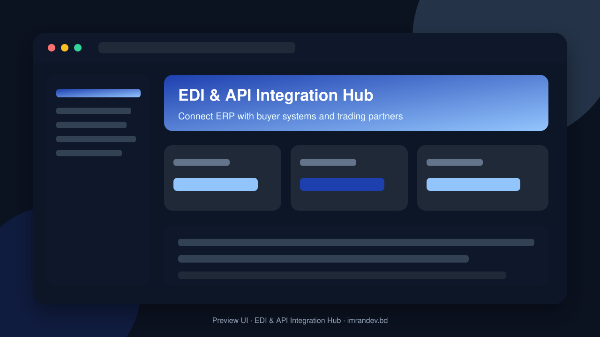
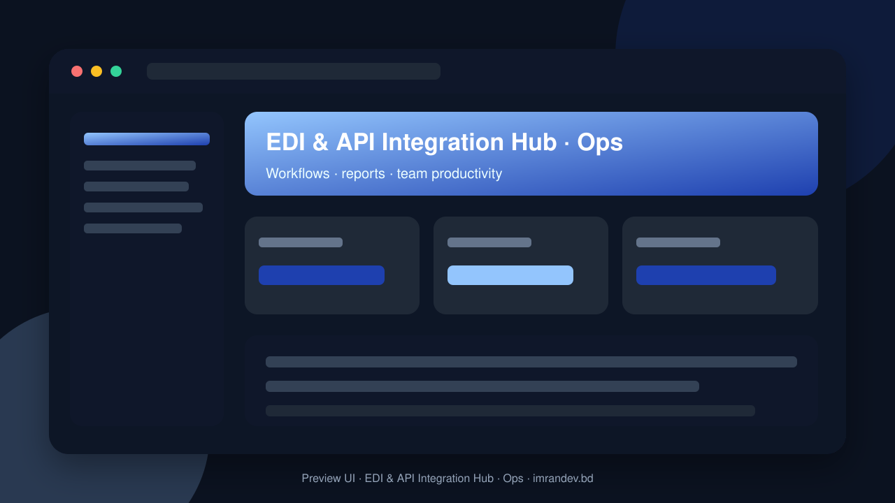

<p align="center">
  
</p>

<h1 align="center">EDI & API Integration Hub</h1>

<p align="center"><strong>Connect ERP with buyer systems and trading partners</strong></p>

<p align="center">
  <a href="https://github.com/imranbru99/edi-api-integration-hub-erp-buyers"></a>
  
  
</p>

---

## Overview

**EDI & API Integration Hub** is a complete business application focused on real operational workflows. This README lists the full feature surface so GitHub visitors and search engines can understand every capability of the product.

## Product preview

| Dashboard | Operations |
| :---: | :---: |
|  |  |

## Complete feature list

### Product modules & capabilities

- EDI Integration Engineer
- DevOps Engineer
- Cybersecurity Engineer
- QA Automation Engineer
- SaaS Product Manager
- Buying houses
- Suppliers and vendors
- Third-party logistics providers
- Warehouse operators
- Global procurement companies
- Redis
- Laravel Queue + Redis
- Laravel Filesystem
- Platform Support Manager
- Platform Finance Manager
- EDI Manager
- Integration Manager
- IT Manager
- Operations Manager
- EDI Operator
- Production Manager
- Warehouse Manager
- Procurement Manager
- Finance Manager
- Supplier User
- Permission management
- Company Management
- Branch Management
- User Management
- Role & Permission Management
- Trading Partner Management
- EDI Gateway
- EDI Standards Management
- EDI Document Management
- EDI Translator
- EDI Mapping Studio
- EDI Validation
- EDI Acknowledgment
- Supplier Integration
- API Management
- Webhook Management
- SFTP Management
- AS2 Management
- Certificate Management
- Error Management
- Retry Management
- Inventory Synchronization
- Purchase Order Management
- Order Acknowledgment
- Shipment Management
- Invoice Management
- Payment and Remittance
- Warehouse Integration
- Reporting and Analytics
- Subscription Management
- Developer Portal
- Audit Management
- Security Center
- Attendance Integration
- System Administration

### Admin / Filament resources

- Api Client
- Branch
- Certificate
- Edi Transaction
- Integration Connection
- Invoice
- Mapping Profile
- Module
- Plan
- Platform User
- Product
- Purchase Order
- Shipment
- Tenant
- Trading Partner
- Transaction Error
- Webhook Endpoint
- Workflow

### Domain models

- Ai Approval Record
- Ai Conversation
- Ai Provider Setting
- Ai Usage Log
- Api Client
- Api Key
- Api Request Log
- Asn Document
- Audit Log
- Belongs To Tenant
- Blog Post
- Branch
- Business Rule
- Certificate
- Contact Request
- Demo Request
- Department
- Document
- Edi Acknowledgment
- Edi Control Number
- Edi Document Type
- Edi Envelope
- Edi Standard
- Edi Transaction
- Edi Transaction Event
- Edi Validation Rule
- Faq
- Feature Flag
- Integration Connection
- Integration Sync Log
- Inventory Record
- Invoice
- Invoice Item
- Login History
- Mapping Approval
- Mapping Field
- Mapping Profile
- Mapping Rule
- Mapping Test Case
- Mapping Version
- Module
- Module Activity Log
- Module Category
- Order Acknowledgment
- Page
- Partner Address
- Partner Connection
- Partner Contact
- Partner Document Type
- Partner Identifier

### HTTP / API controllers

- About APIs & screens
- Api Integration APIs & screens
- Auth APIs & screens
- Blog APIs & screens
- Contact APIs & screens
- Demo APIs & screens
- Developers APIs & screens
- Docs APIs & screens
- Edi Gateway APIs & screens
- Edi Standards APIs & screens
- Edi Transaction APIs & screens
- Erp Integrations APIs & screens
- Faq APIs & screens
- Features APIs & screens
- Home APIs & screens
- Inventory APIs & screens
- Invoice APIs & screens
- Mapping APIs & screens
- Modules APIs & screens
- Pricing APIs & screens
- Purchase Order APIs & screens
- Security APIs & screens
- Shipment APIs & screens
- Solutions APIs & screens
- Trading Partner APIs & screens
- Webhook APIs & screens

### Detailed feature requirements delivered

- Application Name: EDI and API Integration Hub
- Product Category: Enterprise B2B Integration / EDI SaaS / API Management
- Primary Purpose: Connect ERP systems with buyers, suppliers, manufacturers, buying houses, warehouses, retailers and logistics providers.
- Technology: PHP 8.3+, Laravel 12, Filament 3, MySQL 8+, Redis, Livewire
- Architecture: Modular Multi-Tenant SaaS
- Development Approach: Production-oriented, API-first, integration-driven, scalable and extensible.
- PRODUCT VISION
- TECHNOLOGY STACK
- Important: This package describes itself as an alternative to Filament rather than a Filament dependency.
- MULTI-TENANT SAAS ARCHITECTURE
- MULTI-USER AND ROLE MANAGEMENT
- DYNAMIC MODULE MANAGEMENT SYSTEM
- CORE EDI GATEWAY
- EDI STANDARDS AND DOCUMENT TYPES
- EDI MAPPING STUDIO
- TRADING PARTNER MANAGEMENT
- COMMUNICATION PROTOCOLS
- ERP INTEGRATION HUB
- API MANAGEMENT CENTER
- WEBHOOK MANAGEMENT
- TRANSACTION MANAGEMENT AND MONITORING
- BUSINESS WORKFLOW AUTOMATION
- Workflow A: Incoming Purchase Order
- Workflow B: Shipment
- Workflow C: Invoice
- BUYER AND SUPPLIER PORTALS
- INVENTORY AND PRODUCT CATALOG SYNCHRONIZATION
- DOCUMENT MANAGEMENT AND ARCHIVING
- CERTIFICATE AND SECURITY MANAGEMENT
- AI-POWERED INTELLIGENCE
- NOTIFICATION CENTER
- REPORTING AND ANALYTICS
- SUBSCRIPTION AND BILLING MANAGEMENT
- PUBLIC WEBSITE AND MARKETING PAGES
- EDI Standards
- ERP Integrations
- API Integration
- Industry Solutions
- Developer Portal
- Interactive Demo
- Documentation
- Blog / Resources
- Login / Registration
- INTERACTIVE DEMO SYSTEM
- Company: Global Apparel Manufacturing Ltd.
- Business type: Garments Manufacturer.
- DATABASE ARCHITECTURE
- FILAMENT ADMINISTRATION
- Suggested URL: /admin
- Suggested URL: /app
- Suggested URL: /developer
- Suggested URL: /partner
- UI/UX DESIGN REQUIREMENTS
- SECURITY REQUIREMENTS
- PERFORMANCE AND SCALABILITY
- TESTING REQUIREMENTS
- README.MD AND DOCUMENTATION
- INSTALLATION AND DEPLOYMENT
- NON-NEGOTIABLE DEVELOPMENT RULES
- FINAL ACCEPTANCE CRITERIA
- FINAL DELIVERY INSTRUCTIONS

### Platform capabilities

- Multi-role ready structure for operators, managers and admins
- Database migrations and seeders for demo-ready local setup
- Laravel architecture with services/controllers/models separation
- Responsive UI foundation (Blade / Filament where enabled)
- Environment-based config for local and production databases
- GitHub-ready documentation with visual product previews

## Tech stack

- PHP 8.2+ / Laravel
- Filament admin resources (where enabled)
- Vite asset pipeline
- SQLite/MySQL-ready database layer
- Migrations, seeders, and test-ready structure

## Quick start

```bash
git clone https://github.com/imranbru99/edi-api-integration-hub-erp-buyers.git
cd edi-api-integration-hub-erp-buyers
composer install
cp .env.example .env
php artisan key:generate
php artisan migrate --seed
npm install && npm run build
php artisan serve
```

## Repository

- GitHub: https://github.com/imranbru99/edi-api-integration-hub-erp-buyers
- Developer: **Imran Ahmed** · https://imrandev.bd

---

## 🤝 Let's Connect & Collaborate

I am open to **Senior Remote Full-Stack Roles**, AI Platform Architecture Contracts, and Enterprise Technical Advisory.

**Timezone:** UTC+6 (Dhaka / Rangpur, Bangladesh) — flexible overlap with US, UK & EU hours.  
**Delivery:** Async-ready · Slack · Discord · Jira · GitHub · production-first accountability.

| Channel | Handle | Link |
| :--- | :--- | :--- |
| Portfolio | imrandev.bd | https://imrandev.bd |
| Packagist | imrandevbd | https://packagist.org/packages/imrandevbd/ |
| LinkedIn | imranbru99 | https://linkedin.com/in/imranbru99 |
| GitHub | imranbru99 | https://github.com/imranbru99 |
| WhatsApp | +880 1576-918420 | https://wa.me/8801576918420 |
| Email | me@imrandev.bd | mailto:me@imrandev.bd |
| X | @imrandev_bd | https://x.com/imrandev_bd |
| YouTube | @ImranDevBD | https://youtube.com/@ImranDevBD |
